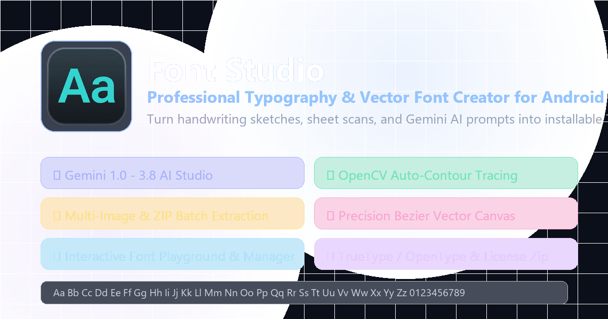
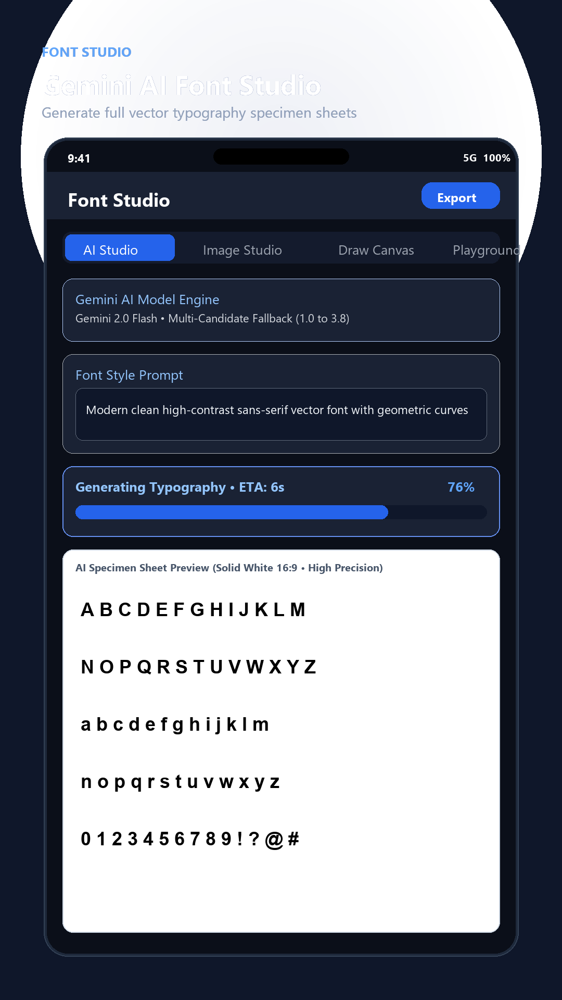
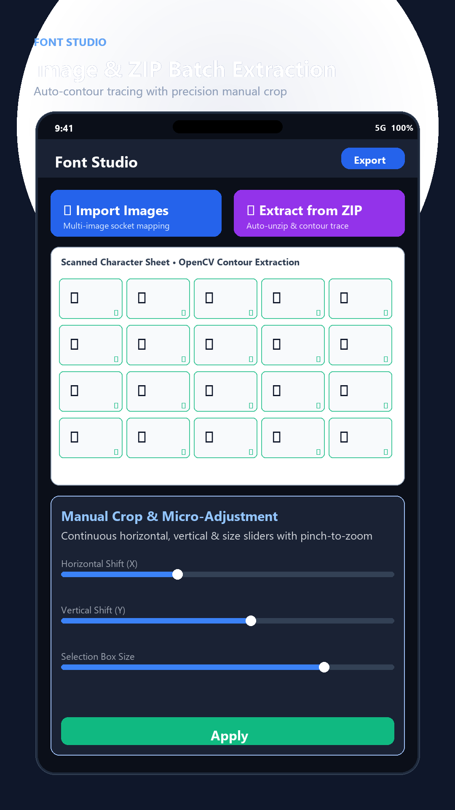
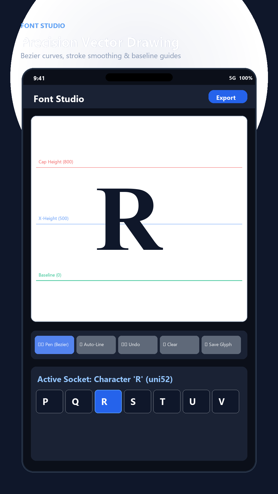
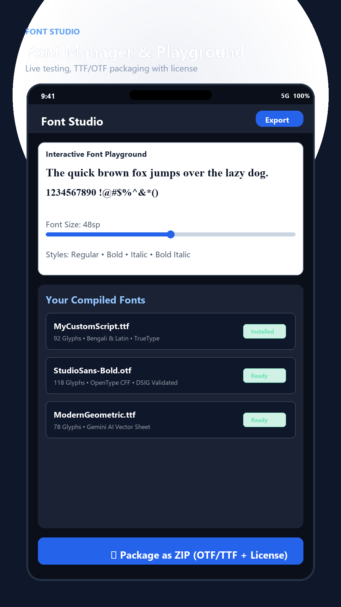

# Font Studio 🖋️✨

> **Professional Typography & Vector Font Creator for Android**  
> Turn handwriting sketches, scanned specimen sheets, and **Google Gemini AI** prompts into installable TrueType (`.ttf`) and OpenType (`.otf`) fonts directly on your Android device.



---

## 🚀 Key Highlights & Capabilities

- 🤖 **Gemini AI Typography Studio**:
  - Connect with Gemini API (`gemini-1.5-flash`, `gemini-2.0-flash`, up to `3.8`).
  - Automatically queries available models with instant fallback support.
  - Hidden prompt engineering: generates high-precision **16:9 solid white background specimen sheets** with zero background artifacts or decorative noise.
  - **Live ETA Ticker**: Dynamic determinate progress bar with real-time countdown (`"Generating Typography • ETA: 12s"`).

- 📦 **Multi-Image & ZIP Batch Extraction**:
  - Import multiple individual character images or extract directly from a `.zip` archive.
  - Automatic character identification and socket mapping (Bengali, Latin, Digits, Symbols).
  - OpenCV-powered contour tracing cleanly extracts characters without including surrounding canvas backgrounds.

- 📐 **Manual Precision Crop & Micro-Adjustment**:
  - Double-tap any glyph socket to launch the precision crop overlay.
  - Continuous horizontal (X), vertical (Y), and size sliders for micro-alignment.
  - Multi-touch pinch-to-zoom and gesture navigation for exact character isolation.

- ✏️ **Vector Drawing Canvas**:
  - High-precision pen tool with smooth Bezier curves.
  - Auto-line straightener for clean strokes.
  - Baseline ($y=0$), X-height ($y=500$), and Cap-height ($y=800$) typographical guides.

- 🔤 **Interactive Font Manager & Playground**:
  - Live typing test sandbox with dynamic font-size slider.
  - Automatic style variant synthesis (Regular, Bold, Italic, SemiBold).
  - Windows Font Viewer & macOS Font Book compatible TrueType/OpenType generation with valid `DSIG` signature table.
  - One-click **Package as ZIP** complete with custom user license and attribution metadata.

---

## 📸 Screenshots & Marketing Showcase

| Gemini AI Font Studio | Image & ZIP Batch Studio |
| :---: | :---: |
|  |  |

| Precision Vector Drawing | Font Manager & Playground |
| :---: | :---: |
|  |  |

---

## 📥 Download Release APK

Pre-compiled, signed release builds are available on the [**Releases**](../../releases) tab:
- **`FontStudio-release.apk`** (Latest signed production release)

---

## 🛠️ Build & Installation

### Requirements
- Android Studio Hedgehog or newer
- JDK 17 or 21
- Android SDK 34 (minSdkVersion 21)

```bash
# Clone the repository
git clone https://github.com/pushpajit-dev/FontStudio.git
cd FontStudio

# Build signed release APK
./gradlew assembleRelease
```

The output APK will be generated at:
`app/build/outputs/apk/release/app-release.apk`

---

## 📄 License & Attribution

Designed and developed by [Pushpajit Roy](https://github.com/pushpajit-dev).  
Licensed under the Apache License 2.0.
